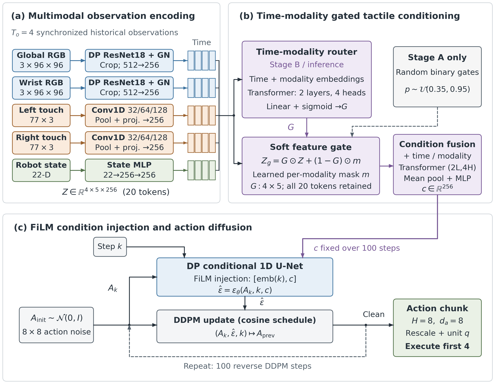
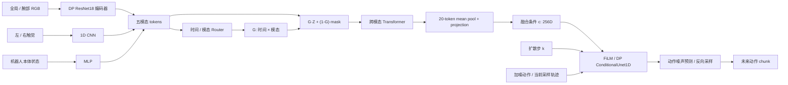

# TacGate-DP

**Time–Modality Gated Tactile Conditioning for Diffusion Policies**  
**时间—模态门控的触觉条件注入扩散策略**

[中文说明](README.md) · [English](README_EN.md) · [方法与公式](docs/METHOD.md) ·
[相关工作与贡献边界](docs/RELATED_WORK.md) · [验证记录](VALIDATION.md)

TacGate-DP 研究**历史触觉信息以多大强度参与动作生成**。左右触觉经 1D CNN
编码为 token；观测条件化 Router 对各历史时刻和各模态预测独立门值；门控后的
触觉与视觉、本体状态通过 Transformer 融合为条件向量，再通过 FiLM 调节
Diffusion Policy（DP）动作 U-Net 的特征。视觉编码器采用 DP 的 ResNet18 流程。

This repository implements time–modality gated tactile conditioning for action
diffusion. Tactile tokens are gated and fused with visual and proprioceptive tokens;
the resulting global condition modulates a DP action U-Net through FiLM.

本目录可直接作为独立 GitHub 仓库根目录。仓库/方法名称为 `TacGate-DP`，
Python 发行包名为 `tacgate-dp`，导入名为 `tactile_gate_policy`。
运行不依赖父目录的参考代码仓库。代码提供训练、恢复、离线评估、动作采样和
适配器闭环的第一版实现；当前验证属于工程验证，未发布真实任务训练权重或成功率。

## 模型与触觉条件注入



论文图：[矢量 PDF](figures/model_architecture.pdf) ·
[可编辑 SVG](figures/model_architecture.svg) ·
[LaTeX 图注](figures/model_architecture.tex) ·
[绘图源码](figures/draw_model_architecture.py)。图使用英文标注，原尺寸为
180 × 140 mm；双栏论文可使用通栏 `figure*`，投稿时优先使用 PDF。



- 模态顺序固定：`global_rgb, wrist_rgb, left_tactile, right_tactile, proprio`。
- 默认观测 4 步、预测 8 步；执行前 4 步期间每步更新观测，随后重新规划。
- 动作是绝对的 `xyz + quaternion(qx,qy,qz,qw) + gripper`，共 8 维。
- `Z_obs` 为 `(B,4,5,256)`，`G` 为 `(B,4,5)`。G 是独立 sigmoid 保留强度。
- Router 与融合网络分别使用参数独立的 Transformer，默认各 2 层、4 个注意力头。
- 同一动作 chunk 的所有逆扩散步骤共享 G 与 `(B,256)` 条件向量。
  FiLM 的 scale/bias 同时依赖该条件和扩散步嵌入，因此仍随 k 变化。
- 动作使用 mean/std 标准化，因此 DDPM 设置 `clip_sample=False`，避免把
  标准化后的动作错误截断到 `[-1,1]`。采样结束后反归一化，并将四元数单位化。

触觉注入包含以下三个环节：

1. **表征进入观测序列。** 左右触觉 CNN 分别产生 256 维 token；默认
   4 个历史时刻共包含 8 个触觉 token，与视觉和状态共同构成 20-token 序列。
2. **调节历史触觉参与强度。** 每个触觉 token 的门值作用于全部 256 个通道，
   控制原始触觉特征与该模态 learned mask 的混合比例。
3. **进入动作去噪条件。** 门控后 token 通过跨时间、跨模态 self-attention，
   再取均值并投影为 c；c 与扩散步嵌入一起生成 U-Net 残差块的 FiLM scale/bias。

门控和融合的核心公式为：

$$
Z_g=G\odot Z+(1-G)\odot m,\qquad
c=\mathrm{Proj}\left(\mathrm{Mean}_{20}\left[
\mathrm{Transformer}_{\mathrm{fusion}}\left(
\mathrm{Flatten}_{T_o,M}(Z_g+E_{\mathrm{time}}+E_{\mathrm{modality}})
\right)\right]\right).
$$

这里的时间轴是**历史观测时间**，与动作扩散步 k 不同。G 是独立 Sigmoid 门值，
不做模态间 Softmax 归一化。Router 的隐藏特征用于生成 G；融合主干使用门控后的
原始编码 token，并有自己的时间、模态嵌入。均值池化作用于 Transformer 交互后的
token，投影为 `LayerNorm → Linear → GELU → LayerNorm`。

当前 FiLM 注入的是视觉、触觉和状态**共同形成的条件 c**。所有 token 位置均保留，
全部编码器和 Router 仍会读取输入；门值均值约束不能解释为计算量节省。
门控效果及其与任务阶段、传感器退化的关系需要任务实验和消融验证。
详见 [METHOD.md](docs/METHOD.md)。

视觉流程保留 DP 的 `ResNet18 -> 去掉 fc`、可选 GroupNorm、训练时随机裁剪、
推理时中心裁剪和 ImageNet normalization。为了给每个相机保留独立 gate，
两个相机特征分别投影成 token。默认不共享相机骨干、不共享左右触觉 CNN。
`vision_weights: null` 对应 DP 原配置的从头训练；设置
`vision_weights: IMAGENET1K_V1` 时，Torchvision 会下载相应权重。
恢复 checkpoint 时不会重新下载。

触觉默认将 231 维按原始索引顺序重排为 **77 个点 × 3 通道**，做 Conv1d，
不假造未知的二维物理网格。此配置假定原始数组是点优先排列；如果传感器的
231 个值不是这种布局，可设置 `tactile_channels: 1`，或在数据适配层按真实
布局重排。前三维 force raw 被丢弃，模型只使用后面的 231 维 distributed tactile。

## 方法定位与贡献

本项目可直接展示的实现贡献包括：时间—模态独立门控条件模块、门控与融合分开的
网络组织、两阶段动作训练流程，以及 FR3/Paxini 数据、恢复训练、评估与推理链路。
这些设计的组合是候选方法贡献，尚需比较实验来证明其效果。

触觉门控、learned mask、注意力融合和触觉条件化 DP 均有先行研究。
尤其 FoAR 已公开与软 mask 同形的力特征门控；Policy Consensus 使用 Router
组合扩散专家；Touch in the Wild 已有触觉 mask 重构预训练与 DP。
本项目不将这些基础机制单独作为首创。相关工作、公开实现状态和建议消融见
[RELATED_WORK.md](docs/RELATED_WORK.md)。

DP 派生代码的来源与许可证单独记录在
[THIRD_PARTY_NOTICES.md](THIRD_PARTY_NOTICES.md)；相关研究的机制相似不意味着
本项目使用了它们的代码。

## 安装

支持 Python 3.9 或更高版本，使用彼此兼容的 PyTorch / Torchvision。
在本目录执行：

```bash
python -m venv .venv
# Windows PowerShell: .venv\Scripts\Activate.ps1
# Linux/macOS: source .venv/bin/activate
python -m pip install --upgrade pip
python -m pip install -e .
```

上述安装注册 `tacgate-train`、`tacgate-evaluate`、`tacgate-rollout` 命令；
原来的 `tgp-*` 命令也可使用。下文统一采用 Python 模块入口，导入名不受目录名影响。

重绘论文图需要可选绘图依赖：

```bash
python -m pip install -e ".[figures]"
python figures/draw_model_architecture.py
```

绘图脚本从本仓库 `PolicyConfig` 读取默认尺寸，不导入 PyTorch 或下载模型权重。

GPU 用户应先按设备安装匹配的 PyTorch / Torchvision。
包不会依赖任何开发者机器的绝对路径，也不会自动下载训练数据。

## FR3 数据格式

```text
dataset_root/
├── data/episodes/episode_000000.parquet
├── images/...png
└── tactile/...zarr
```

Parquet 是同步主表。必要字段包括：

| 字段 | 内容 |
|---|---|
| `frame_index`, `timestamp`, `sync.valid` | 帧索引、秒时间戳、同步有效标记 |
| `image.path`, `wrist_image.path` | 相对 dataset_root 的真实图片路径 |
| `robot.ee_pose`, `robot.q`, `robot.dq`, `robot.gripper_pos` | 7+7+7+1=22 维本体状态 |
| `action.sent_action8` | 8 维动作，四元数顺序 x,y,z,w |
| `tactile.left/right.zarr_path`, `tactile.left/right.zarr_index` | 相对路径和数组行号 |
| `tactile.left/right.force_raw_len` | 3 |
| `tactile.left/right.distribution_raw_start` | 3 |
| `tactile.left/right.distribution_raw_len` | 231 |

触觉 Zarr 数组为 `(T,234)`，分布值取后 231 维，原始范围 `[0,255]`。
路径解析限制在 dataset_root 内。同步无效的窗口会被过滤；时间戳不递增、
采样间隔异常或数值不合法时会明确报错。

每个窗口是 4 步历史观测，然后紧接 8 步未来动作，不跨 episode 或拆分边界。
多 episode 时按 episode 拆分；只有一个 episode 时，按互斥连续时间块拆分。
归一化统计只从训练集计算并随模型保存。训练不缓存可被反复归一化的 batch。

**采样频率必须一致。** 默认 YAML 使用 `frame_stride: 3` 和
`control_dt: 0.3`，对应原始约 10 Hz 数据每隔 3 帧采样。若要保留 10 Hz，
同时修改为 `frame_stride: 1`、`control_dt: 0.1`。训练会检查实际时间戳间隔，
不会仅依据配置字段假定控制频率。

## 分阶段训练

Stage A 使用随机二值 gate，冻结 Router，训练条件网络和动作头。
默认同时训练真实视觉 / 触觉编码器，因为默认骨干没有预训练权重。
随机 gate 的保留概率直接用于 Bernoulli 采样，每个观测时刻至少保留一个模态。

```bash
python -m tactile_gate_policy.train --config configs/stage_a.yaml --dataset-root /path/to/dataset --output-dir runs/stage_a --device cuda:0
```

Stage B **加载 Stage A 权重**，启用 Router，并继续训练整个主干。
默认冻结已训练的编码器；可将 `freeze_encoders` 改为 false 做联合微调。
也可以用已有 Stage B checkpoint 做 `--init-checkpoint`，重新建立优化器后继续微调。

| 阶段 | 门值来源 | 编码器（默认） | Router | mask / 融合网络 / 动作 U-Net |
|---|---|---|---|---|
| Stage A | 随机 Bernoulli 门；每样本保留概率取 `[0.35,0.95]` | 训练 | 跳过并冻结 | 训练 |
| Stage B | 观测 Router 的独立 Sigmoid 门 | 冻结 | 训练 | 训练 |

两个阶段都以动作噪声预测训练；Stage A 不包含触觉图像或观测重构目标。

```bash
python -m tactile_gate_policy.train --config configs/stage_b.yaml --dataset-root /path/to/dataset --output-dir runs/stage_b --init-checkpoint runs/stage_a/best.pt --device cuda:0
```

Stage B 默认损失：

```text
L = noise_prediction_MSE
  + 0.1 × (mean(G) - 0.65)²
  + 0.02 × mean(|G[:,1:] - G[:,:-1]|)
```

左右触觉对称正则默认 0，不强制两侧权重相同。
`mean(G)` 项约束门的平均保留强度；平滑项约束同一观测窗口内相邻历史时刻的门，
不等于对不同闭环控制周期间的门值施加平滑约束。
优化器为 AdamW，使用 warmup/cosine 学习率和梯度裁剪。

同阶段中断恢复使用 `--resume`；切换阶段使用 `--init-checkpoint`。

```bash
python -m tactile_gate_policy.train --config configs/stage_b.yaml --dataset-root /path/to/dataset --output-dir runs/stage_b --resume runs/stage_b/last.pt --device cuda:0
```

checkpoint 包含模型、编码器、normalizer、优化器、学习率调度器、拆分信息、
epoch/batch/step 与 RNG 状态。固定数据和同一执行环境下，恢复会跳过已经处理
的 batch。`--max-steps N` 可以将一次运行停在全局第 N 步，之后用更大的 N 恢复。
恢复时要求训练配置一致（包括 epochs）；设备、CPU 线程数和 max_steps 可以改变。
若要改变训练轮数或其他训练配置，用 `--init-checkpoint` 开始新的微调运行。

每个阶段输出 `last.pt`、验证损失最小的 `best.pt`、`config.yaml` 和
`metrics.jsonl`。已存在的训练目录需要显式 resume，避免覆盖权重。

## 离线评估与推理

```bash
python -m tactile_gate_policy.evaluate --checkpoint runs/stage_b/best.pt --dataset-root /path/to/dataset --output-dir runs/evaluation --device cuda:0
```

评估使用 checkpoint 中记录的验证拆分，输出位置 MAE、夹爪 MAE、四元数角度
误差（弧度）、混合动作 MSE，写入 `metrics.json`，并保存 `predictions.npz`。
`metrics.json` 中的 `gate_heatmap` 是时间—模态门值的数值矩阵，可用于另行绘图。
位置和夹爪误差沿用原数据单位。这些指标衡量演示动作拟合，不能当作任务成功率。

程序接口：

```python
from tactile_gate_policy.checkpoint import load_policy

policy, metadata = load_policy("runs/stage_b/best.pt", device="cpu")
# obs 是未经本体 / 触觉归一化的原始 batch：
# RGB: float32[0,1], (B,4,3,H,W)
# tactile: float32[0,255], (B,4,231)
# proprio: float32, (B,4,22)
prediction = policy.predict_action(obs)
actions_to_execute = prediction["action"]       # (B,4,8)
complete_chunk = prediction["action_pred"]      # (B,8,8)
gate = prediction["gate"]                      # (B,4,5)
```

## 闭环执行

内置 ToyRobotAdapter 使用 FR3 的 22 维本体状态，可验证
“观测缓存 -> 预测 -> 执行前几步 -> 更新观测”的闭环：

```bash
python -m tactile_gate_policy.rollout --checkpoint runs/stage_b/best.pt --adapter toy --max-steps 40
```

接入实际 FR3 时，实现 `rollout.RobotAdapter` 的两个方法：

```python
class MyRobotAdapter:
    def observe(self):
        # 阻塞等待下一控制时刻的同步观测。
        # 返回 global_rgb / wrist_rgb / left_tactile / right_tactile / proprio。
        ...

    def execute(self, action8, control_dt):
        # 下发机械臂坐标系中的绝对动作，负责控制周期和硬件约束。
        # 返回 True 表示 episode 已结束。
        ...

def make_adapter(policy_config):
    return MyRobotAdapter()
```

随后使用 `--adapter my_robot_module:make_adapter`。
Runner 采集真实历史帧，按 n_action_steps 执行，并记录推理耗时。
本仓库没有连接 FR3 的 SDK、设备地址或控制器；真实硬件适配需要由部署环境提供。

## 验证

```bash
python -m unittest discover -s tests -v
python scripts/smoke_test.py
```

无需 pytest。测试使用临时生成的 PNG、Parquet 和 Zarr 数据；覆盖像素编码、
CNN / Router 梯度、同步窗口与拆分隔离、归一化往返、确定性采样、
checkpoint 恢复、阶段迁移、离线评估及 Toy 闭环。
smoke 会实际运行短 Stage A、resume、Stage B、动作采样和评估，完成后删除
自身生成的临时数据。测试不下载预训练权重，不读取父目录的数据。

GitHub Actions 提供 Windows / Linux CPU 验证。数据、checkpoint、输出日志和
本地验证产物已配置为不提交。第三方代码和许可证见 `THIRD_PARTY_NOTICES.md`。

## 研究扩展

当前实现第一版观测特征门控。动作条件化 `G_action(B,H,To,M)`、
`G -> K_obs` 模态噪声等级和完整多模态联合扩散，属于后续研究方向，
未作为已经实现的能力宣传。
